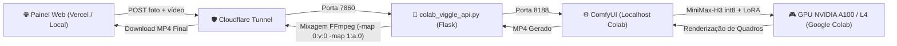

# 🎬 Studio Video AI — Motor Viggle-Animate (ComfyUI)

Painel web profissional para geração de vídeos com transferência corporal completa e animação neural de alta performance através do motor de código aberto **Viggle-Animate (MiniMax-H3)** via **ComfyUI**.

[](https://colab.research.google.com/github/grego921/studio-video-ai/blob/main/Viggle_Studio_Colab.ipynb)

---

## ⚡ Como Funciona a Arquitetura



1. **Painel Web (Frontend)**: Interface moderna em Dark Mode (`templates/index.html` e `html_template.py`) que roda localmente ou na nuvem (Vercel Serverless).
2. **Ponte de GPU (Google Colab Pro)**: Executa o notebook `Viggle_Studio_Colab.ipynb` com GPU de alta capacidade de VRAM (NVIDIA A100 de 40/80 GB ou L4 de 24 GB).
3. **Servidor API REST (`colab_viggle_api.py`)**: Gerencia fila de tarefas, upload de mídia, monitoramento por websocket do ComfyUI e mixagem final de áudio.
4. **Gerador de Workflow (`build_viggle_workflow.py`)**: Converte dinamicamente o workflow oficial de interface para o formato ComfyUI API Prompt direto do `/object_info`.

---

## 🚀 Guia Passo a Passo de Execução

### Passo 1: Abrir e Rodar o Google Colab
1. Abra o caderno oficial clicando no botão:
   [](https://colab.research.google.com/github/grego921/studio-video-ai/blob/main/Viggle_Studio_Colab.ipynb)
2. No menu do Colab, vá em:
   **Ambiente de execução** → **Alterar tipo de ambiente de execução** → Selecione **GPU A100** ou **L4** (requer Colab Pro devido ao modelo de ~21 GB).
3. Execute todas as células em ordem:
   - **Célula 1**: Diagnóstico de GPU e confirmação de VRAM mínima (>= 21.5 GB).
   - **Célula 2**: Instalação do ComfyUI oficial e dos 4 custom nodes essenciais (`ComfyUI-Viggle-Animate-H3`, `ComfyUI-VideoHelperSuite`, `ComfyUI-KJNodes`, `comfyui-various`).
   - **Célula 3**: Download automatizado dos pesos int8 do Hugging Face (`minimax_h3_ref2va_viggle_pruned_int8_convrot.safetensors`, LoRA DMD 4-step, text cond e VAE).
   - **Célula 4**: Inicialização do ComfyUI em modo alta performance na porta `8188`.
   - **Célula 5**: Execução do gerador de workflow (`build_viggle_workflow.py`), inicialização da API REST na porta `7860` e abertura do túnel público seguro do Cloudflare.

### Passo 2: Copiar o Link do Túnel
Ao concluir a Célula 5, o terminal exibirá:
```text
===========================================================================
🎉 MOTOR GPU VIGGLE-ANIMATE CONECTADO COM SUCESSO!
👉 URL DO MOTOR GPU : https://exemplo-aleatorio.trycloudflare.com
===========================================================================
```
Copie a URL `https://...trycloudflare.com`.

### Passo 3: Conectar no Painel Web
1. Abra o painel web (hospedado na Vercel ou rodando localmente via `python app.py` em `http://localhost:5000`).
2. Clique no botão superior direito **Conectar Motor GPU**.
3. Cole a URL copiada e clique em **Salvar e Conectar**.
4. O indicador mudará para **🟢 Motor GPU Ativo (NVIDIA A100)**.

### Passo 4: Enviar Mídias e Gerar
1. **Foto de Referência (Image)**: Carregue a imagem nítida da pessoa ou personagem que deseja animar.
2. **Vídeo de Movimento (MP4 de até 5 s)**: Carregue o vídeo de referência corporal (máximo 124 quadros / ~5 segundos a 24 fps). O corpo e movimentos deste vídeo serão transferidos à foto.
3. *(Opcional)* **Áudio**: Digite o texto para síntese de voz (Edge TTS) ou envie um áudio MP3/WAV. O áudio será perfeitamente mixado como trilha no vídeo final.
4. Clique em **Gerar Vídeo Agora**. Acompanhe os estágios em tempo real (Carregamento de modelos, Condicionamento, Amostragem e Decodificação) e faça o download do MP4 gerado.

---

## 💻 Executando o Painel Web Localmente

Para rodar a interface web no seu computador:

```bash
# 1. Instale as dependências
pip install -r requirements.txt

# 2. Inicie o servidor web
python app.py
```
Acesse no navegador: `http://localhost:5000`.

---

## 📂 Estrutura de Arquivos

| Arquivo | Função |
| :--- | :--- |
| `Viggle_Studio_Colab.ipynb` | Caderno oficial do Google Colab (instalação, modelos e inicialização do ComfyUI) |
| `colab_viggle_api.py` | Servidor Flask de backend na porta 7860 (ponte entre ComfyUI e frontend) |
| `build_viggle_workflow.py` | Converte o workflow oficial de interface para o formato ComfyUI API Prompt |
| `workflows/viggle_api.json` | Workflow em formato API validado contra o ComfyUI |
| `app.py` | Servidor web Flask local para servir a interface |
| `templates/index.html` | Interface SPA moderna com suporte completo ao motor Viggle-Animate |
| `html_template.py` | Espelho sincronizado do HTML para implantação Vercel Serverless |
| `test_audio_mapping.py` | Teste automatizado de validação espectral (FFT) da mixagem de áudio |

---

## 🔒 Segurança e Backup
- O estado prévio com suporte ao SadTalker está preservado na branch `sadtalker-backup` e na tag Git `sadtalker-final`.
